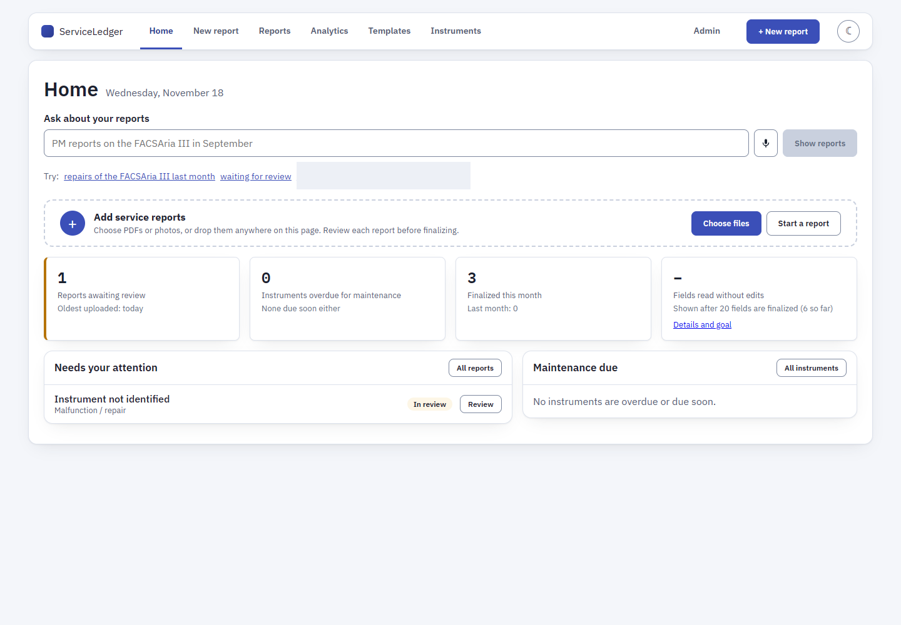
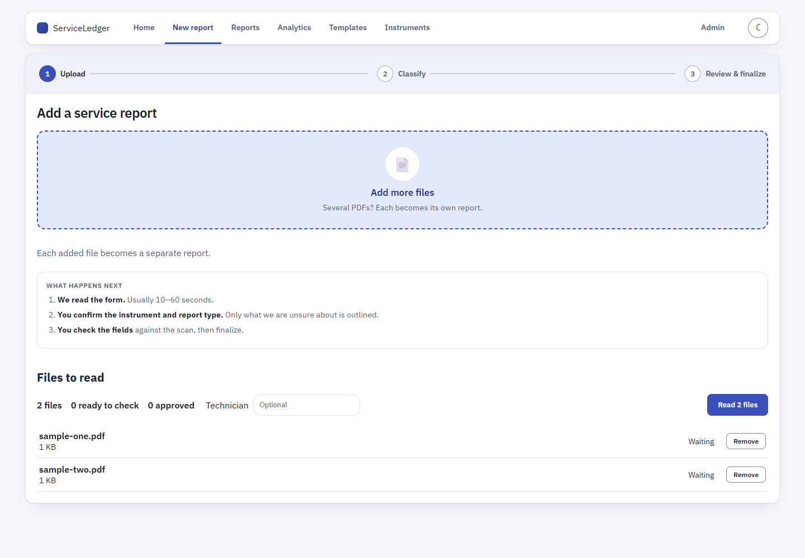
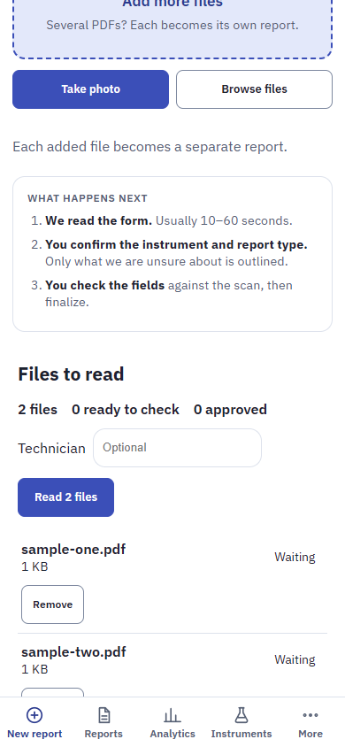
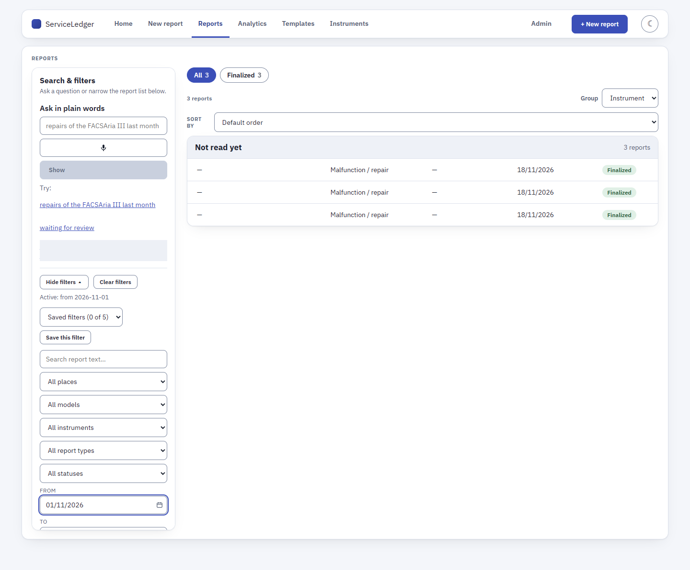
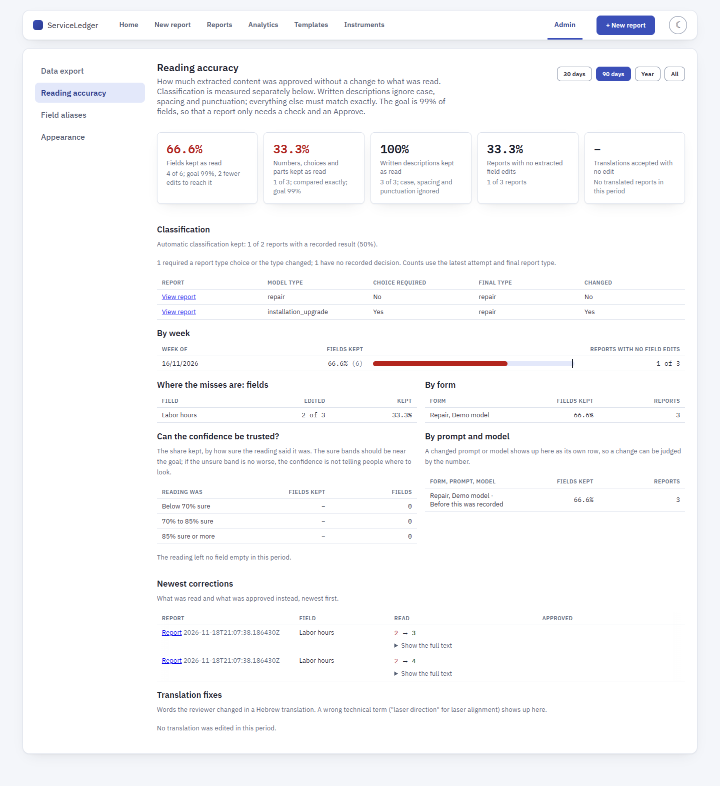

# ServiceLedger WIP update for Regev

18 November 2026 · Product snapshot `71919f9` · [Standalone HTML](ServiceLedger-briefing-for-Regev.html)

We’re making it easier to upload several reports, find and review them, and see where automatic classification needs a person’s input. The snapshot is on this WIP branch. It has not been merged or deployed. See the [engineering handoff](../WIP-2026-11-18.md) for implementation details.

## What’s on the WIP branch

- **Multiple-PDF upload.** PDFs enter a queue on the New report screen. You can add files from the same picker, carry the optional technician value into the queue, and start reading the batch. Each PDF becomes a separate report.
- **Home and report filters.** Home makes upload and the review queue clearer and distinguishes an instrument loading error from an empty maintenance list. Reports shows active filters and lets you clear them while the controls are collapsed.
- **Dates and review fields.** Review and filters accept `DD/MM/YYYY`. Related screens use the same date format, while the API still uses ISO dates. The affected read-only review field displays as plain text.
- **Classification accuracy.** Reports can retain classification attempts. The accuracy screen counts automatic results kept, results needing attention, and reports without recorded decisions separately from extraction edits.
- **Labor-hours comparison.** Instrument comparisons use the same parser as fleet analytics, including decimal commas and alternate field names. The set of report types included in the totals is unchanged.

## Screenshots from the published product commit

These captures show commit `71919f9` running against an isolated database with synthetic records. A built-in search example was masked in the screenshots. The browser check exercised Home, the desktop and mobile upload queue, a report date filter, and the Classification panel. It left the files queued and did not exercise live document processing.

**Home.** Upload controls and the count of reports awaiting review.

**Desktop upload queue.** Two sample PDFs are waiting inside New report.

**Mobile upload queue.** Two sample PDFs are waiting before processing.

**Reports.** A date filter entered as `DD/MM/YYYY`. The active-filter summary still shows the same date in ISO format.

**Reading accuracy.** The Classification section is separate from extraction metrics. The seeded examples show an automatic result kept, a result that needed attention, and a report without a recorded decision. The percentages illustrate the layout and are not accuracy measurements.

## Separate feature work

Six local branches cover reading progress and scan visibility, review checks and extraction confidence, text search for reports awaiting review, mixed PDF and photo grouping, further UI polish, and a visual template editor. Some UI changes overlap with this WIP snapshot.

## What remains before merge

1. Run a complete multi-PDF batch through processing and review. Check desktop and mobile filters, day-first dates and CSV, and automatic and manual classification paths on the candidate being reviewed.
2. Separate overlapping changes into reviewable PRs. Sequence the classification history, review continuity, and pending search migrations and verify a single migration chain.
3. Decide whether installation and upgrade reports should count toward fleet and instrument labor-hour totals when hours are recorded. The current totals include repair and preventive maintenance.
